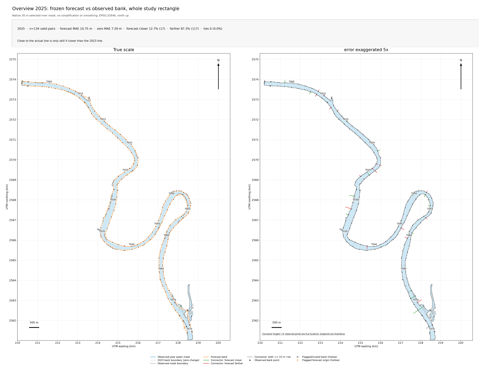
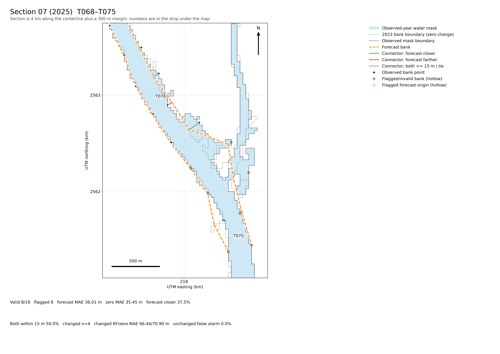

# 2025 forecast vs observed bank line

**Prepared:** 2026-10-24  
**Status:** Retrospective diagnostic. No model, threshold, frozen artifact, or evaluation file was changed.

## Question

How closely does the frozen 2023→2025 predicted bank line follow the measured March 2025 bank line?

The 2025 forecast is a **two-year forecast from the 2023 edge**, not a one-year 2024→2025 forecast. This report measures the line at the 75 bank points on each side, using the same valid pairs as the existing evaluation.

## Bottom line

The predicted line **looks close over most of the river**, but it is **not reliable for large bank movements**.

- **Typical miss (median): 4.6 m**
- **77%** of usable bank points are within **15 m**
- **93%** are within **30 m**
- **Average miss: 10.75 m**, but the 90th percentile is **28.2 m** and the worst miss is **127.0 m**
- The forecast is **worse than assuming no change**: zero-change average miss is **7.29 m**
- It caught only **1 of 25** movements of 15 m or more with the right direction and class

The line is close because most banks barely moved. Where a bank did move a lot, the forecast usually stayed near the 2023 position.

*Figure 1: Frozen forecast (orange dashed) against the observed 2025 bank (black). The left panel is true scale; the right panel multiplies only connector lengths by 5 so small differences are visible. The observed points are true locations. Source: `figures/compare_2024_2026/overview_2025.png`.*

## What was compared

- **Prediction:** `forecasts/frozen/banklines_2025.geojson`, a cumulative forecast from the 2023 observed bank to 2025, with 75 points on each bank.
- **Observation:** `evaluation/observed_banklines_2025.geojson`, measured on **2025-03-25**, also with 75 points on each bank.
- **Unit of comparison:** one bank point (one transect on one side). There are 150 points in total, 75 left and 75 right.
- **Valid pairs:** **134 of 150**. The other **16** were excluded because the starting bank or observed bank was flagged for a border transect or multiple crossings, consistent with the frozen evaluation.
- **Error:** predicted displacement minus observed displacement along the bank normal. Positive means the forecast was too far outward; negative means too far inward. The absolute error is the size of the miss.
- **Baseline:** the 2023 bank held unchanged (“zero change”) on the same 134 pairs.
- The point distance used here equals the along-transect error for these records to within 0.01 m. The line is built from these points.

This is **not a new blind test**. The 2025 observations were already opened in the frozen evaluation. It is a focused re-reading of that comparison to answer the line-alignment question.

## Headline numbers

| Measure | 2025 result |
|---|---:|
| Valid bank points | 134 |
| Typical miss (median) | 4.56 m |
| Average absolute miss (MAE) | 10.75 m |
| Big-miss-weighted average (RMSE) | 19.55 m |
| Mean signed error | +3.00 m (slightly too far outward) |
| 90th percentile miss | 28.17 m |
| Worst miss | 126.96 m |
| Forecast within 5 m | 70 / 134 (52.2%) |
| Forecast within 15 m | 103 / 134 (76.9%) |
| Forecast within 30 m | 124 / 134 (92.5%) |
| Forecast closer than zero change | 17 / 134 (12.7%) |
| Forecast farther than zero change | 117 / 134 (87.3%) |
| Zero-change average miss | 7.29 m |

The forecast is **3.45 m worse per point on average than doing nothing**. It is closer than zero on only 12.7% of points and farther on 87.3%. There are no exact ties.

### What “77% within 15 m” does and does not mean

The 15 m cut is the project’s low-movement tolerance. A point can be within 15 m of the observed bank simply because both the observed bank and the forecast stayed near the 2023 position. That is why the line can look well aligned while the forecast still loses to zero change.

“Within 15 m” describes positional closeness. It is **not** a 77% accuracy score and does not mean the forecast captured the movement.

## Distribution of misses

| Miss size | Bank points | Share |
|---|---:|---:|
| At most 5 m | 70 | 52.2% |
| At most 10 m | 95 | 70.9% |
| At most 15 m | 103 | 76.9% |
| At most 30 m | 124 | 92.5% |
| At most 50 m | 129 | 96.3% |
| More than 30 m | 10 | 7.5% |
| More than 50 m | 5 | 3.7% |

There is a long tail: most points are only a few metres off, but 31 points miss by more than 15 m and 10 miss by more than 30 m.

The forecast compresses movement toward zero:

- Predicted 2025 displacements range from **−13.5 m to +28.9 m**.
- Observed 2025 displacements on the same valid pairs range from **−63.2 m to +146.8 m**.

The model never predicts a large inward movement and never predicts a large outward movement anywhere near the observed maximum.

## By bank and reach

| Scope | Points | Mean miss | Median miss | RMSE | Within 15 m |
|---|---:|---:|---:|---:|---:|
| Left bank | 67 | 11.50 m | 3.39 m | 22.25 m | 49 (73.1%) |
| Right bank | 67 | 9.99 m | 4.78 m | 16.41 m | 54 (80.6%) |
| North reach | 44 | 10.44 m | 5.21 m | 15.02 m | 30 (68.2%) |
| Middle reach | 48 | 8.40 m | 2.63 m | 16.17 m | 41 (85.4%) |
| South reach | 42 | 13.75 m | 6.16 m | 26.16 m | 32 (76.2%) |

The **south reach** has the largest average miss, driven by the two largest left-bank errors. The **middle reach** has the best median and average. The north reach has fewer points inside 15 m than the south even though its average miss is smaller, because its errors are more evenly spread.

## Where the line fails

The ten largest misses account for about **37% of the total absolute error**, which is why the average is so much larger than the median:

| Transect | Bank | Reach | Predicted (m) | Observed (m) | Miss (m) | What happened |
|---|---|---|---|---:|---:|---:|---|
| T071 | Left | South | +19.9 | +146.8 | **127.0** | Severe underprediction of a large outward move |
| T031 | Right | Middle | +2.6 | −63.2 | **65.8** | Predicted slight outward; bank moved strongly inward |
| T069 | Left | South | +5.2 | +68.7 | **63.5** | Severe underprediction |
| T029 | Right | Middle | −7.1 | −60.9 | **53.8** | Right direction but far too small |
| T070 | Left | South | +17.5 | −35.2 | **52.7** | Wrong direction |
| T045 | Right | Middle | +3.5 | −34.2 | **37.7** | Wrong direction |
| T039 | Left | Middle | −4.0 | +30.1 | **34.1** | Wrong direction |
| T060 | Right | South | +0.3 | −32.0 | **32.3** | Essentially zero predicted; bank moved inward |
| T032 | Right | Middle | −1.7 | −32.2 | **30.5** | Right direction but far too small |
| T004 | Left | North | −0.0 | −30.1 | **30.1** | Essentially zero predicted; bank moved inward |

Positive values mean outward movement; negative values mean inward movement.

The worst single error is on the left bank in the south. The actual bank moved outward about **147 m**, while the forecast moved outward only **20 m**. That one point contributes about **0.95 m** to the 10.75 m average by itself.

The large errors are not concentrated in only one place: the middle and south reaches both contain multiple 30–66 m misses.

*Figure 2: The south section containing the 147 m observed movement. The forecast (orange dashed) and observed boundary (black) diverge most at the lower end. Several points in this section are flagged, so this figure is context, not a replacement for the valid-pair table. Source: `figures/compare_2024_2026/section_2025_07.png`.*

## Large-movement capture

Among the 134 valid pairs:

- **25 points** moved at least 15 m in the observed bank.
- The forecast assigned a non-low class to only **8 points** overall.
- Only **1 of the 25** moving points received the correct class and direction.
- **23 of 25** moving points were classified as little change.
- **1 of 25** was classified in the opposite direction.
- Of the 109 observed stable points, **6** were incorrectly flagged as moving: a **5.5% false-movement rate**.
- The model predicted **no accretion class** among the 134 valid pairs; the observed bank had **17 accretion points**.

The sign was right on 15 of the 25 moving points, but 14 of those still predicted less than 15 m of movement. Getting the broad sign right while predicting a tiny displacement is not enough to mark a change hotspot.

This is the central limitation: the forecast is a **low-movement line**, and the 2025 data are dominated by stable banks. Its apparent visual alignment is mostly correct behaviour on stable reaches, not successful prediction of change.

## Full-line check

As a separate check, I sampled the drawn predicted line every 10 m and measured its nearest distance to the drawn observed line, in UTM zone 46N. Both left and right banks were included.

| Measure | Result |
|---|---:|
| Samples | 5,061 |
| Mean distance | 10.9 m |
| Median distance | 5.08 m |
| 90th percentile | 25.03 m |
| Within 15 m | 77.4% |
| Within 30 m | 93.4% |

This agrees with the point analysis: roughly 5 m typical gap and roughly 11 m average. It is descriptive only because it includes all line vertices, including the 16 flagged observation points, and nearest-line distance is not the same as the official valid-pair score.

## What this means

1. **The line is visually good on stable banks.** Most of the river is within a few metres of the observed line, and almost all of it is within 30 m.
2. **It is not a validated movement forecast.** It loses to zero change, rarely improves on holding the 2023 bank, and misses nearly all large movements.
3. **Do not describe this as “77% accurate.”** The appropriate description is: “close in stable reaches; unreliable where the bank moves substantially.”
4. **Do not tune on 2025.** The year was already opened; changing the model or threshold now would invalidate the frozen comparison. A credible improvement needs new information or independent observations, not a re-fit to this result.
5. **Keep the map warning.** The forecast line should remain a scenario with the existing “not a safety rating” label. The line and risk ribbons should not be presented as evidence that a particular place is safe or unsafe.

## Reproduction

The numbers come from existing files; no new forecast was generated:

- Per-pair truth, prediction, error, baseline, and flags: `evaluation/predictions.csv`
- Frozen evaluation summary: `evaluation/metrics.json`
- Frozen predicted line: `forecasts/frozen/banklines_2025.geojson`
- Observed 2025 line: `evaluation/observed_banklines_2025.geojson`
- Existing comparison report: `reports/compare_2024_2026.md`
- Existing figures: `figures/compare_2024_2026/overview_2025.png`, `full_2025.png`, `section_2025_07.png`

Filter `evaluation/predictions.csv` to `year == 2025` and `label_quality == good`, then use `model_abs_error_m`, `zero_abs_error_m`, and `observed_displacement_m`. Those 134 rows reproduce the 10.75 m forecast MAE, the 7.29 m zero MAE, and the event counts in this report.

## Caveats

- The comparison is retrospective and not blind because 2025 was already part of the frozen test set.
- Sixteen points are excluded for measurement flags. Their removal follows the frozen evaluation rule; including them would change the descriptive line-distance check but would not make the forecast more reliable.
- The 15 m cut is the project's low-movement tolerance, not a safety or engineering threshold.
- The observed line is a selected water-mask boundary simplified to 75 points per bank; the comparison uses the measured transect positions, not the visual chord lengths.
- A close line does not imply correct risk classification, and a single year does not establish skill.
