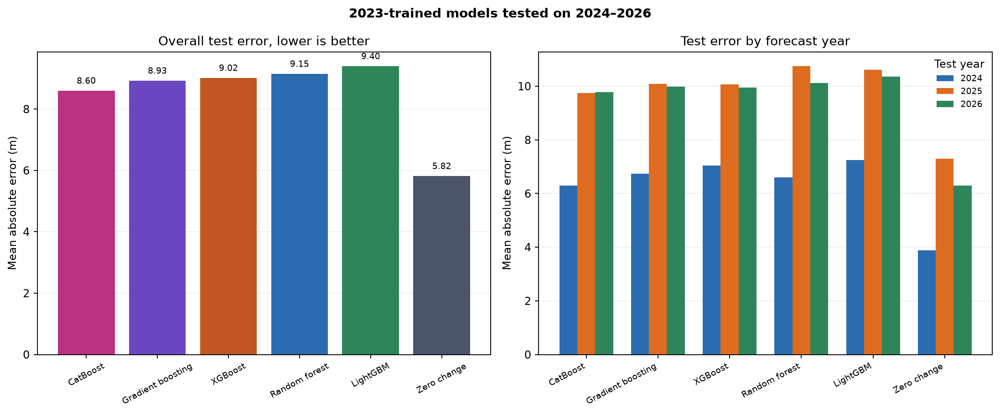

# Five-model comparison: trained through 2023, tested on 2024–2026

**Prepared:** 2026-10-25  
**Status:** Isolated post-hoc experiment. The frozen forecast, API, UI, existing evaluation, and app dependencies were not changed.

## Bottom line

I trained **random forest, scikit-learn gradient boosting, XGBoost, LightGBM, and CatBoost** on data through 2023 and scored all five on the same 398 valid 2024–2026 pairs.

**No model beat the no-change baseline on MAE.**

| Model | Test MAE | Compared with no change |
|---|---:|---:|
| **CatBoost** | **8.60 m** | 2.78 m worse |
| Gradient boosting | 8.93 m | 3.11 m worse |
| XGBoost | 9.02 m | 3.20 m worse |
| Random forest | 9.15 m | 3.33 m worse |
| LightGBM | 9.40 m | 3.58 m worse |
| **No change (reference)** | **5.82 m** | — |

CatBoost was the best of the five machine-learning models, and it was the best machine-learning model in each test year. That does **not** make it a validated replacement for the app: it is still clearly worse than doing nothing, and choosing it from these test scores would be test-set selection.



*Figure 1: Overall test MAE (left) and test MAE by year (right). Lower is better. The no-change baseline is not a fitted model; it is the reference that all five models must beat.*

## What was trained and tested

- **Training:** `datasets/bank_migration_dataset.csv`, restricted to `target_year <= 2023` and `usable_for_training`.
- **Training rows:** 8,425 total: 2,959 for horizon 1, 2,810 for horizon 2, and 2,656 for horizon 3.
- **Test features:** `datasets/forecast_features_2023.csv`, all 150 bank points for each of 2024, 2025, and 2026.
- **Test truth:** `evaluation/predictions.csv`, used only for scoring after all models were fitted.
- **Evaluation set:** 398 valid pairs — 134 in 2024, 134 in 2025, and 130 in 2026. The other 52 rows were excluded under the existing frozen evaluation rule because their origin or observed bank was flagged.
- **Design:** One model per horizon, exactly matching the existing frozen forecast design. The 2024 test uses the horizon-1 model, 2025 the horizon-2 model, and 2026 the horizon-3 model.
- **Features:** The 20 features recorded in `models/model_metadata.json`. Each model/horizon pipeline fits median imputation on its own training rows only; no test row informed imputation. Because every model sees the same training matrix, the imputed matrices match across models.
- **Test years:** 2024–2026 are already part of the opened frozen test set. This is **not a new blind test**.

The retrained random forest reproduces the frozen random forest exactly: same 9.148572 m MAE, with a maximum prediction difference of **7.1 × 10⁻¹⁵ m**. That confirms the merge and split match the official evaluation.

## Fixed model settings

I used fixed, comparable settings and did **not** tune any model on 2024–2026.

| Model | Settings used for each horizon |
|---|---|
| Random forest | 300 trees, minimum leaf 5, `max_features=0.75`, seed 42 |
| Gradient boosting | 300 trees, learning rate 0.05, depth 3, minimum leaf 20, squared error |
| XGBoost | 300 rounds, learning rate 0.05, depth 3, min child weight 5, subsample 0.9, column sample 0.9, L2 1.0 |
| LightGBM | 300 trees, learning rate 0.05, 15 leaves, min child samples 20, subsample 0.9, column sample 0.9, L2 1.0 |
| CatBoost | 300 iterations, learning rate 0.05, depth 4, L2 3.0, RMSE loss |

All five use the same imputed feature matrix. The libraries were loaded from a temporary directory outside the app environment. Versions: scikit-learn 1.9.1, XGBoost 3.4.1, LightGBM 4.7.0, CatBoost 1.2.10, pandas 3.0.6, NumPy 2.5.4.

## Overall results

Lower MAE and RMSE are better. Positive bias means the model was, on average, too far outward. `Within 15 m` is the share of points whose absolute error was at most the project's 15 m low-movement tolerance.

| Model | MAE | RMSE | Bias | Within 15 m | Low-movement F1 | Directional accuracy on moving points | Missed movement rate | Closer than no change |
|---|---:|---:|---:|---:|---:|---:|---:|---:|
| **CatBoost** | **8.60 m** | 15.68 m | +3.18 m | 82.2% | 0.905 | 54.7% | 92.2% | 40 / 398 |
| Gradient boosting | 8.93 m | 15.75 m | +3.44 m | 81.4% | 0.906 | 56.3% | 84.4% | 44 / 398 |
| XGBoost | 9.02 m | 15.78 m | +3.80 m | 81.2% | 0.899 | 56.3% | 89.1% | 41 / 398 |
| Random forest | 9.15 m | 15.90 m | +2.90 m | 80.4% | 0.897 | 59.4% | 89.1% | 43 / 398 |
| LightGBM | 9.40 m | **15.57 m** | +3.39 m | 79.2% | 0.891 | **60.9%** | 84.4% | 44 / 398 |
| No change | **5.82 m** | 15.72 m | +1.53 m | **83.9%** | **0.913** | 0% by definition | 100% | 398 ties |

The five machine-learning models occupy a narrow band from **8.60 to 9.40 m MAE**. The no-change baseline is **2.78–3.58 m better than every one of them on MAE**.

The models are closer than no change on only 40–44 of 398 pairs, or roughly **10–11%**. They are farther on the remaining 354–358 pairs. There are no exact ties.

### The one metric where a model slightly beats no change

LightGBM has RMSE **15.57 m**, slightly below no change at **15.72 m**. That does not make it the best model overall:

- Its MAE is **9.40 m**, versus **5.82 m** for no change.
- It has the largest false-movement rate of the five, **6.6%**.
- Its lower RMSE comes from making the largest observed movements somewhat less costly, while adding errors on the many stable points.

The choice of metric therefore matters, and MAE is the headline metric already used by the project.

## Results by test year

All values are MAE in metres.

| Year | Valid pairs | No change | CatBoost | Gradient boosting | XGBoost | Random forest | LightGBM |
|---|---:|---:|---:|---:|---:|---:|---:|
| 2024 | 134 | **3.88** | 6.30 | 6.75 | 7.05 | 6.61 | 7.24 |
| 2025 | 134 | **7.29** | 9.75 | 10.08 | 10.07 | 10.75 | 10.61 |
| 2026 | 130 | **6.29** | 9.78 | 9.98 | 9.96 | 10.12 | 10.36 |

CatBoost is the lowest-MAE machine-learning model in all three years. No model is close to no change in any year. The gap is smallest for CatBoost in 2024 and 2025, but still about 2.4–2.5 m.

## Large-movement performance

The test set has **64 large movements**: 22 outward erosion points and 42 inward accretion points, using the 15 m tolerance. The remaining 334 points are low movement.

| Model | Erosion captured | Accretion captured | Total captured | Missed as low movement | False alarms on stable points |
|---|---:|---:|---:|---:|---:|
| CatBoost | 2 / 22 | 2 / 42 | **4 / 64** | 92.2% | **2.7%** |
| Gradient boosting | 6 / 22 | 3 / 42 | **9 / 64** | 84.4% | 3.9% |
| XGBoost | 6 / 22 | 1 / 42 | 7 / 64 | 89.1% | 4.5% |
| Random forest | 3 / 22 | 2 / 42 | 5 / 64 | 89.1% | 4.8% |
| LightGBM | 5 / 22 | 4 / 42 | **9 / 64** | 84.4% | 6.6% |
| No change | 0 / 22 | 0 / 42 | 0 / 64 | 100% | 0% |

“Captured” means the model's class exactly matched the observed class at the 15 m tolerance. A model can get the broad direction right while still predicting less than 15 m of movement; that does not count as a captured event.

The trade-off is visible:

- **CatBoost** is the most conservative. It has the fewest false alarms, labels 59 of 64 large movements as low movement, and captures only 4.
- **Gradient boosting and LightGBM** catch the most large movements, 9 of 64 each, but pay for that with more errors on stable banks.
- **None** catches more than 4 of 42 accretion events.

This is the same failure mode as the frozen model: the forecasts stay near zero and compress the large movements.

## Error profiles

The average error hides a long tail:

| Model | 10th percentile error | Median error | 90th percentile error | Largest absolute error |
|---|---:|---:|---:|---:|
| CatBoost | −5.6 m | +2.0 m | +19.5 m | 131.7 m |
| Gradient boosting | −6.7 m | +1.9 m | +20.3 m | 119.9 m |
| XGBoost | −5.9 m | +2.2 m | +21.1 m | 118.5 m |
| Random forest | −7.9 m | +1.1 m | +21.8 m | 127.0 m |
| LightGBM | −8.7 m | +2.3 m | +20.3 m | 115.6 m |

Every model has a positive median error around **1–2 m**, meaning the typical forecast is slightly too far outward. Every model still has at least one miss above **115 m**.

The pointwise winner changes with the row: random forest has the smallest absolute error on 131 of 398 points, CatBoost on 99, gradient boosting on 80, LightGBM on 49, and XGBoost on 39. The aggregate ranking is driven by the size of the large misses, not by one model dominating everywhere.

## What the models used

The average ranked feature importance across the three horizon models:

| Model | Top features |
|---|---|
| Random forest | last 3-year mean rate, width, sinuosity, curvature, last rate |
| Gradient boosting | last 3-year mean rate, last rate, width, sinuosity, last 2-year mean rate |
| XGBoost | last rate, bank side, last interval quality, last 3-year mean rate, last displacement |
| LightGBM | curvature, width, sinuosity, last 3-year mean rate, last 2-year mean rate |
| CatBoost | last 3-year mean rate, width, last 2-year mean rate, curvature, sinuosity |

These are descriptive split-usage summaries, not causal effects. The models broadly rely on recent movement history, channel width, and local curvature.

## What this means

1. **Keep the no-change baseline as the benchmark.** It remains the strongest 2024–2026 predictor by MAE.
2. **Do not promote CatBoost or any other model into the app based on this report.** All five lose to no change, and the comparison uses the already-opened test years.
3. **Do not tune on 2024–2026.** Hyperparameters were fixed in advance. A future model choice must be made on rolling pre-2023 validation, then tested once on independent data.
4. **If the goal is large-movement detection, test a different target or added information.** The current feature set and labels make the models conservative. Gradient boosting and LightGBM reduce large-movement error somewhat, but not enough to beat zero overall.
5. **The app remains unchanged.** The frozen random forest and its risk-zone presentation are still the only served forecast.

A defensible next experiment would be to tune on rolling validation origins through 2022, choose one model by a pre-registered rule, and then evaluate it on a genuinely held-out reach or on 2027+ data. This report is a performance description, not that selection experiment.

## Reproduce

The isolated script is `scripts/compare_models_2023.py`. It reads only the training table, test features, frozen metadata, and evaluation labels; it writes only under `reports/model_comparison_2024_2026/` and `reports/figures/`.

The optional libraries were installed outside the app environment:

```bash
cd /media/saad/HDD/rivererosionaccretion
.venv/bin/pip install --target /tmp/opencode/river-model-libs --no-deps xgboost lightgbm catboost
PYTHONPATH=/tmp/opencode/river-model-libs .venv/bin/python scripts/compare_models_2023.py
```

The app environment was not modified. No frozen file, model artifact, API file, UI file, or evaluation file was written.

Artifacts:

- `reports/model_comparison_2024_2026/results.json` — full metrics, settings, versions, hashes, and feature importance
- `reports/model_comparison_2024_2026/predictions.csv` — per-pair predictions and errors
- `reports/model_comparison_2024_2026/overall_metrics.csv`
- `reports/model_comparison_2024_2026/by_year.csv`
- `reports/model_comparison_2024_2026/feature_importance.csv`
- `reports/figures/model_comparison_2024_2026.png`

## Caveats

- This is a **post-hoc** comparison on test years that were already opened. It cannot serve as blind evidence for choosing a model.
- Hyperparameters were fixed, not tuned. A different tuning budget could change the ranking.
- The 450 test rows are 150 per year, but the 398 valid rows cover only 138 unique transect-side combinations. They are repeated observations over three horizons, not 398 independent locations.
- The 52 flagged points are excluded, consistent with the frozen evaluation.
- MAE is dominated by the many stable points; large-movement capture is reported separately to avoid hiding that weakness.
- The 15 m tolerance is a project convention, not a safety threshold.
- No confidence intervals are shown. Differences of a few tenths of a metre between the five models should not be treated as a confident ranking.
- The models share the same 20-feature input and median imputation. Boosted models might handle missing values differently without imputation, but that would be a separate experiment.
